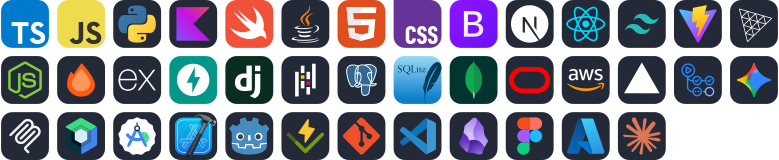

  

## about

software developer, app builder & security enthusiast. focused on typescript, python, mobile apps, and the web. building android and ios apps, websites, back-end apis, and security tools.

🌐 [github.com/vhrcam](https://github.com/vhrcam) • ✉️ [cnewman69@ivytech.edu](mailto:cnewman69@ivytech.edu)

---

## core skills

  

- **languages:** typescript • python • kotlin • java • javascript • html/css • sql • swift • gdscript
- **python:** django • fastapi • pandas • tkinter • asyncio • websockets • pyinstaller • unit testing
- **web:** html/css • bootstrap • react • next.js • tailwind css • vite • three.js • responsive design
- **android:** jetpack compose • views/xml • viewmodel/stateflow • room • retrofit • workmanager
- **ios:** swift • swiftui • swiftdata • @observable state • canvas & shapes • gestures • async/await • figma → swiftui
- **back end:** node.js • express • hono • rest apis • jwt auth • mcp servers • gemini api • imap
- **databases:** sqlite/room • mongodb • oracle sql • postgres • turso • dynamodb • database design (erds, 3nf)
- **security:** sha-256 hashing • fernet/aes • rsa • x25519 + chacha20 • owasp • secret scanning
- **tools:** git • github actions • android studio • xcode • vs code • godot • azure • aws • vercel • render • figma • obsidian • claude code
